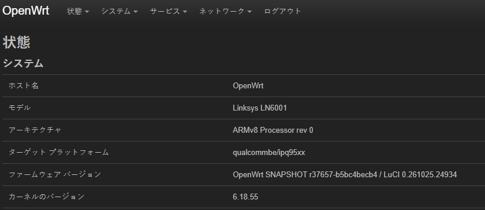

# Linksys Velop WRT Pro 7 LN6001 Community Firmware

## 日本語

Linksys Velop WRT Pro 7 (LN6001 / MBE70)  OpenWrt ルーターの最新コミュニティファームウェアです。  
[Suricata](https://suricata.io/)と[Emerging Threats Open](https://rules.emergingthreats.net/open/)を活用したネットワーク保護機能に対応。IoT機器やホームネットワーク向けに選定した検知ルールで、既知のマルウェア通信やボットネット活動、ネットワーク機器を狙う攻撃を検知します。機能を有効にすると、選定した高確度の検知ルールに基づいて不正な通信を自動遮断。不審な通信や遮断イベントは、ルーターの管理画面で確認できます。また、、[Threat Intelligence Feeds (TIF) DNS Blocklist - mini version](https://github.com/hagezi/dns-blocklists#tifmini)を活用したWEBフィルタリングにてフィッシング詐欺、マルウェア、スパイウェアなどの悪意のあるドメインなどを自動的に遮断します。有料の脅威情報サブスクリプションは不要です。 ※IPS/IDS及びWebフィルタリング機能はインターネット設定実施後に有効化してください。

### 主な機能

- **VPN 接続に対応：** [WireGuard](https://www.wireguard.com/)、[Tailscale](https://github.com/tailscale/tailscale)、IPsec を利用可能。
- **IPoE 接続に対応。**
- **地域に合わせた Wi-Fi：** 国・地域別 Wi-Fi パッケージと、工場出荷時のキャリブレーションを使用。
- **ボタン操作でメッシュ Wi-Fi：** WPS ボタンを使ってメッシュ接続をセットアップ。
- **IoT 機器の保護：** 不審な通信の検知・防御を支援する IPS/IDS（不正侵入防止・不正侵入検知システム）。
- **[Adblock](https://github.com/openwrt/packages/blob/master/net/adblock/README.md)に対応。**

使ってみた感想、不具合の報告、改善のアイデアをぜひお寄せください。
OpenWrt のコミュニティーと、LN6001 の開発・テストに協力してくださる皆さんに感謝します。

### リリース情報

| 項目 | 内容 |
| --- | --- |
| ステータス | 公開済み（非公式コミュニティリリース） |
| 公開日 | 2026-10-28 |
| リリースブランチ | `261027` |
| バージョン | `25.12.26102722` |
| 対応モデル | Linksys LN6001 / MBE70WRT |
| OpenWrt | `SNAPSHOT r37657-b5bc4becb4` |
| Linux カーネル | `6.18.55` |

LuCI のシステム情報画面（OpenWrt と Linux カーネルのバージョン表示）。

### ダウンロード

[ファームウェアをダウンロード](https://raw.githubusercontent.com/ikm-san/ln6001-lab/refs/heads/261027/firmware/FW_LN6001_v25.12.26102722_openwrt_release.img)。
インストール前に [SHA256SUMS](firmware/SHA256SUMS) でダウンロードしたファイルを確認してください。

###  バックアップパーティションに切り替える方法

注意事項：OpenWrtファームウェアからは純正のリテールファームウェアには戻せませんので、２つあるパーティションのうち１つは純正ファームウェアのために残すようにしてください。

LN6001 は、OS起動用のパーティションが２つ用意されています。A/Bの２種類のうち、A側からファームウェアのアップデートを行うと、B側のパーティションを更新します。バックアップパーティションに切り替えるには、ルーターの起動を 3 回中断すると通常は別のファームウェアスロットに切り替わります。

1. 電源スイッチをONにして起動中に約 5 秒後に電源スイッチを切ります。
2. この操作を合計 3 回行います。
3. 4 回目は電源を入れたまま数分待つと、バックアップスロットが起動します。

### インストール

1. ルーターが **LN6001 / MBE70WRT** であることを確認します。
2. 設定のバックアップが必要な場合は保存し、ルーターにPC を Ethernet で接続します。
3. Linksys 純正 Web インターフェースの手動ファームウェア更新画面を開きます。
4. 本リリースのダウンロードファイルを選択し、**設定を保持する**オプションを
   無効にします。
5. 更新を開始し、再起動が完了するまで電源を切らずに待ちます。
6. PC の DHCP リースを更新し、[http://192.168.1.1/](http://192.168.1.1/) を開きます。
7. CPE 底面ラベルに記載されたパスフレーズを使って root としてログインし、
   root パスワードを変更します。
8. **ネットワーク → 無線**で国コード、チャンネル、帯域幅、送信出力を確認します。

Wi-Fi のパスフレーズも CPE 底面のラベルに記載されています。

### 関連プロジェクト・フィルターリスト

本リリースを支える OSS プロジェクトとフィルターの提供元です。
各プロジェクトの皆さんに感謝します。

| プロジェクト・フィルター | 主な役割 |
| --- | --- |
| [OpenWrt](https://openwrt.org/) | ファームウェアの基盤 |
| [LuCI](https://github.com/openwrt/luci) | Web 管理画面 |
| [Suricata](https://suricata.io/) | IPS/IDS |
| [Emerging Threats Open](https://rules.emergingthreats.net/open/) | 脅威検知ルール |
| [OpenWrt adblock](https://github.com/openwrt/packages/blob/master/net/adblock/README.md) | DNS ベースの広告ブロック |
|  |
| [HaGeZi TIF mini](https://github.com/hagezi/dns-blocklists#tifmini) | 悪意のあるドメインのブロックリスト |
| [WireGuard](https://www.wireguard.com/) | VPN |
| [Tailscale](https://github.com/tailscale/tailscale) | VPN クライアント |

### 補足

- このリリースは **LN6001 / MBE70WRT 専用**です。
- LuCiのファームウェア更新メニューよりインストール可能です。raw `mtd`
  書き込みや強制 `sysupgrade` は対象外です。

[LICENSES.md](LICENSES.md) に記載された各コンポーネントのライセンスに基づき、
現状有姿で提供されます。

---

## English

**This is a community release. It is not an official release from Linksys or the OpenWrt project.**

This is the latest community firmware for the Linksys Velop WRT Pro 7
(LN6001 / MBE70) OpenWrt router.

Network protection uses [Suricata](https://suricata.io/) and [Emerging Threats Open](https://rules.emergingthreats.net/open/), with detection rules
selected for IoT devices and home networks. These rules help detect known malware
traffic, botnet activity, and attacks targeting network devices. When enabled,
the feature automatically blocks malicious traffic based on selected
high-confidence detection rules. You can review suspicious traffic and blocking
events in the router's administration interface.

Web filtering uses the [Threat Intelligence Feeds (TIF) DNS Blocklist - mini version](https://github.com/hagezi/dns-blocklists#tifmini) to automatically block malicious domains associated with phishing,
malware, spyware, and other threats. No paid threat intelligence subscription
is required.

**Enable IPS/IDS and web filtering after completing your Internet connection setup.**

### Highlights

- **VPN ready:** [WireGuard](https://www.wireguard.com/), [Tailscale](https://github.com/tailscale/tailscale), and IPsec support.
- **IPoE ready.**
- **Wi-Fi for your region:** Uses Wi-Fi packages for your country or region and factory calibration data.
- **Mesh Wi-Fi at the push of a button:** Set up mesh connections using the WPS button.
- **Protection for IoT devices:** IPS/IDS (intrusion prevention and intrusion detection systems) helps detect and block suspicious network traffic.
- **[Adblock](https://github.com/openwrt/packages/blob/master/net/adblock/README.md) support.**

Feedback, bug reports, and ideas are welcome. Thanks to the OpenWrt community
and everyone helping develop and test LN6001 support.

### Release information

| Item | Value |
| --- | --- |
| Status | Published (unofficial community release) |
| Publication date | 2026-10-28 |
| Release branch | `261027` |
| Version | `25.12.26102722` |
| Supported models | Linksys LN6001 / MBE70WRT |
| OpenWrt | `SNAPSHOT r37657-b5bc4becb4` |
| Linux kernel | `6.18.55` |

LuCI system status showing the OpenWrt and Linux kernel versions.

### Download

[Download the firmware](https://raw.githubusercontent.com/ikm-san/ln6001-lab/refs/heads/261027/firmware/FW_LN6001_v25.12.26102722_openwrt_release.img).
Before installation, verify your download against [SHA256SUMS](firmware/SHA256SUMS).

### Switching to the backup partition

**Important:** You cannot reinstall the stock retail firmware from OpenWrt.
Keep the stock firmware on one of the two partitions.

The LN6001 has two partitions for booting the operating system, A and B.
Updating the firmware while running from partition A writes the update to
partition B. To switch to the backup partition, interrupt the router's startup
three times. This normally causes it to select the other firmware slot.

1. Turn the power switch on, then turn it off after about five seconds while
   the router is starting up.
2. Repeat this sequence three times in total.
3. On the fourth power-on, leave the router powered on for several minutes
   until it boots from the backup slot.

### Installation

1. Confirm that the router is an **LN6001 / MBE70WRT**.
2. Back up your settings if needed, then connect your computer to the router
   using Ethernet.
3. Open the manual firmware-update page in the Linksys stock web interface.
4. Select the downloaded release file and disable **Keep settings**.
5. Start the update and keep the router powered on until it finishes rebooting.
6. Renew the computer's DHCP lease and open
   [http://192.168.1.1/](http://192.168.1.1/).
7. Sign in as root using the passphrase printed on the CPE's bottom label, then
   change the root password.
8. Review the country code, channel, channel width, and transmit power under
   **Network → Wireless**.

The Wi-Fi passphrase is also printed on the CPE's bottom label.

### Projects and filter lists

Thanks to the open-source projects and filter maintainers behind this release.

| Project or filter | Role |
| --- | --- |
| [OpenWrt](https://openwrt.org/) | Firmware platform |
| [LuCI](https://github.com/openwrt/luci) | Web administration interface |
| [Suricata](https://suricata.io/) | IPS/IDS |
| [Emerging Threats Open](https://rules.emergingthreats.net/open/) | Threat detection rules |
| [OpenWrt adblock](https://github.com/openwrt/packages/blob/master/net/adblock/README.md) | DNS-based ad blocking |
|  |
| [HaGeZi TIF mini](https://github.com/hagezi/dns-blocklists#tifmini) | Malicious-domain blocklist |
| [WireGuard](https://www.wireguard.com/) | VPN |
| [Tailscale](https://github.com/tailscale/tailscale) | VPN client |

### Notes

- This release is for the **LN6001 / MBE70WRT only**.
- You can install this release through the firmware update menu in LuCI.
  Raw `mtd` writes and forced `sysupgrade` are outside this procedure.

See [LICENSES.md](LICENSES.md). The firmware is provided as-is under the
licenses of its included components.
